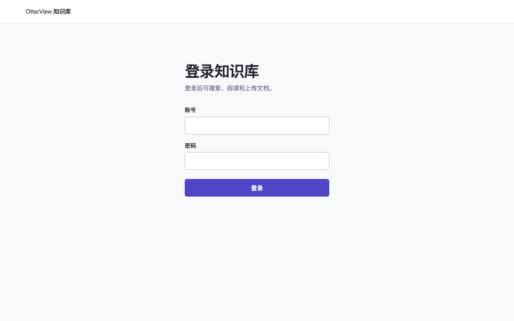
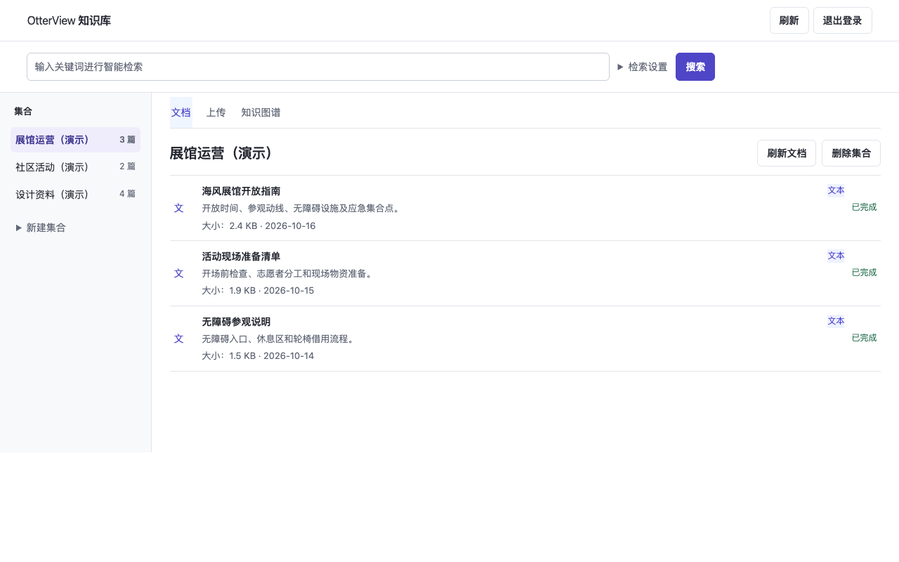
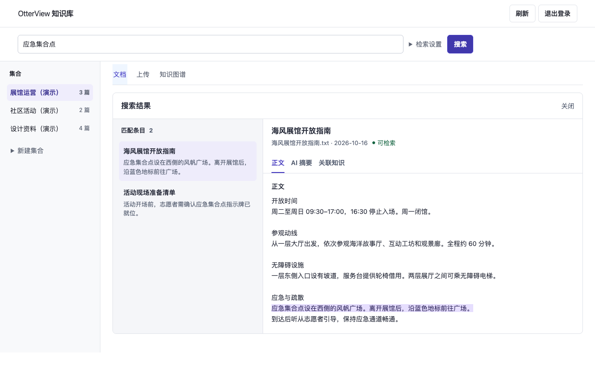

# OtterView 知识库

[English](README.md) · [Apache License 2.0](LICENSE)

OtterView 知识库是一个可自托管的文档工作台。资料按集合管理，支持批量上传、关键词和语义检索。搜索结果与原文并排显示，文档详情可切换正文、AI 摘要和关联知识。正文入库后即可检索，全文摘要和已启用的知识图谱在后台生成。

独立站使用一个共享操作账号，适合个人或可信团队。它不提供每人独立账号或多租户隔离。

## 界面预览

截图中的集合和文档均为虚构演示数据。

**登录页**

**工作台首页**

**搜索结果与原文**

## 快速开始

1. 按 [快速开始](README.md#quick-start) 创建本地账号并填写 `.env`，配置你自己的对话模型和向量模型。
2. 运行 `docker compose up -d --build`，打开 [本地登录页](http://127.0.0.1:18006/login)。
3. 登录后新建集合、上传文档，再搜索正文里的关键词。全文摘要的处理状态可在 **AI 摘要** 标签中查看。

[独立部署与 HTTPS](docs/operations/STANDALONE_WORKSPACE.md) · [后台任务、OCR 和图谱](docs/operations/DEFERRED_ENRICHMENT.md) · [源码来源](docs/PROVENANCE.md)
